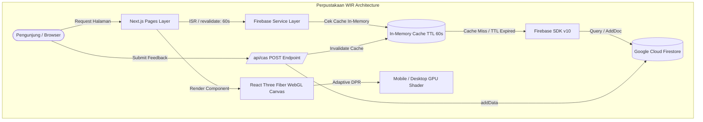

# 📚 Perpustakaan WIR — Smart Reading Space & Digital Library

<p align="center">
  
</p>

<p align="center">
  <strong>Platform Pustaka Digital Generasi Baru dengan Estetika Apple Liquid Glass, Kanvas 3D WebGL Fotorealistik, dan Integrasi Database 100% Real-Time Firebase Firestore.</strong>
</p>

<p align="center">
  
  
  
  
  
  
  
  
</p>

---

## 🌟 Ikhtisar Proyek (Project Overview)

**Perpustakaan WIR** adalah aplikasi web perpustakaan modern yang berbasis di Cikarang. Aplikasi ini dirancang dari fondasi arsitektur enterprise untuk memberikan pengalaman membaca dan eksplorasi literasi digital yang imersif. 

Berbeda dari portal perpustakaan konvensional, Perpustakaan WIR memadukan:
1. **Desain Liquid Glass (Apple & Dribbble Benchmark):** Lapisan material kaca cair dengan efek refraksi *specular rim highlight*, saturasi warna dinamis, dan kedalaman transparan yang elegan.
2. **Visualisasi 3D WebGL Fotorealistik:** Animasi buku *hardcover*, lampu baca klasik antik (*banker's lamp*), kepakan halaman buku perpustakaan terbuka, dan partikel debu cahaya matahari (*sunbeam dust motes*) menggunakan **React Three Fiber** & **Three.js**.
3. **Arsitektur 100% Data-Driven Firebase Firestore:** Seluruh katalog kategori, inventaris buku, artikel berita, dan aspirasi kotak suara pengunjung tersimpan dan dikelola langsung melalui database cloud Firebase Firestore tanpa manipulasi *mock data* atau array statis.

---

## 💎 Fitur Unggulan (Core Features)

- **⚡ Incremental Static Regeneration (ISR):** Seluruh halaman katalog dan beranda memanfaatkan rendering hybrid Next.js dengan `revalidate: 60` untuk kecepatan muat sub-detik sekaligus menjamin pembaruan data database yang selalu segar.
- **🛡️ Cache Invalidation & In-Memory TTL Layer:** Layer servis Firebase dilengkapi dengan caching in-memory 60 detik untuk memangkas *read latency* dan menghemat kuota operasional Firestore.
- **📝 Kotak Suara & Feedback Real-Time (`/cas`):** Formulir aspirasi pembaca yang terhubung langsung dengan koleksi `cas` di Firestore melalui API route `/api/cas` dengan dukungan method `GET` dan `POST`.
- **📱 Optimasi GPU & Baterai Mobile (Adaptive DPR):** Komputasi shader 3D mendeteksi resolusi dan form-factor perangkat. Pada ponsel (<768px), *Device Pixel Ratio* diturunkan ke `[1, 1.1]` dan jumlah partikel dipangkas guna menjaga stabilitas 60 FPS tanpa panas berlebih.
- **🖼️ Next.js Native Image Pipeline:** Seluruh visual buku dan artikel memanfaatkan komponen `next/image` dengan format WebP generasi baru, *responsive layout sizing*, dan *lazy loading*.
- **📐 Tata Letak Responsif Bebas Overflow:** Teruji mulus dari layar HP ekstra ramping (320px) hingga layar monitor resolusi ultra-tinggi (4K).

---

## 🛠️ Tech Stack & Arsitektur Sistem

### Komponen Teknologi Utama

| Layer / Domain | Teknologi | Versi | Peran & Tanggung Jawab |
| :--- | :--- | :--- | :--- |
| **Framework** | [Next.js](https://nextjs.org/) | `14.0.4` | SSR, SSG, ISR, API Routes, Asset Optimization |
| **UI Library** | [React](https://react.dev/) | `^18.2.0` | Declarative UI, Component State, Hooks |
| **Database Cloud** | [Firebase Firestore](https://firebase.google.com/) | `^10.7.1` | NoSQL Cloud Database, Document Storage, Real-Time Sync |
| **3D Rendering** | [React Three Fiber](https://r3f.docs.pmnd.rs/) / [Three.js](https://threejs.org/) | `^8.18.0` / `^0.160.1` | Kanvas 3D WebGL, Procedural Shaders, Parallax Scene |
| **3D Helpers** | [@react-three/drei](https://github.com/pmndrs/drei) | `^9.122.0` | Float controls, Camera Rigging, Buffer Helpers |
| **Styling** | [Tailwind CSS](https://tailwindcss.com/) | `^3.3.0` | Design Tokens, Liquid Glass Classes, Responsive Breakpoints |
| **Bahasa Pemrograman** | [TypeScript](https://www.typescriptlang.org/) | `^5.0.0` | Type Safety, Strict Schema Interfaces, Linting |
| **Ikon Grafis** | [Lucide React](https://lucide.dev/) | `^1.61.0` | Vector Iconography Modern & Ringan |

### Diagram Alur Data Sistem (System Data Flow)



---

## 📋 Skema Database Firestore (Firestore Collections)

Database Firestore diorganisasikan dalam 5 koleksi dokumen utama:

| Koleksi | Deskripsi | Dokumen Contoh & Properti Kunci |
| :--- | :--- | :--- |
| `categories` | Master kategori genre buku perpustakaan. | `id`, `title`, `image`, `explanation` *(9 dokumen: Pemrograman, Petualangan, Biografi, Sejarah, Novel, Fantasi, Sains, Komik, Pelajaran)* |
| `detail_categories` | Katalog buku fisik & digital dengan relasi kategori. | `id`, `categoryId`, `categoryName`, `title`, `author`, `image`, `rating`, `borrows`, `tag`, `tagColor`, `explanation` |
| `blogs` | Berita pengumuman dan liputan kegiatan perpustakaan. | `id`, `title`, `date`, `news`, `image` *(5 dokumen liputan WIR & GDSC)* |
| `detail_blogs` | Naskah lengkap artikel jurnal dan publikasi ilmiah. | `id`, `title`, `date`, `news`, `image` |
| `cas` | Forum aspirasi pembaca, kritik, saran, & usulan buku baru. | `id`, `name`, `email`, `phone`, `category`, `message`, `avatar`, `role`, `status`, `statusColor`, `adminReply`, `createdAt` |

---

## 💻 Panduan Instalasi Lokal (Local Setup Guide)

### 1. Prerequisites (Prasyarat Sistem)
Pastikan lingkungan pengembangan lokal Anda telah terpasang:
- **Node.js:** Versi `>= 18.17.0` (Sangat disarankan: Node.js 20 LTS atau Node.js 24)
- **Package Manager:** `npm` (versi `>= 9.x`) atau `pnpm` / `yarn` / `bun`
- **Git:** Versi terbaru untuk *version control*

### 2. Kloning Repositori
```bash
git clone https://github.com/syahrizaia/project-library.git
cd project-library
```

### 3. Instalasi Dependensi
```bash
npm install
```

### 4. Konfigurasi Variabel Lingkungan (`.env.local`)
Buat file bernama `.env.local` pada direktori *root* proyek dan lengkapi kredensial Firebase project Anda:

```env
# ===================================================
# KONFIGURASI FIREBASE CLOUD FIRESTORE
# ===================================================
FIREBASE_API_KEY=AIzaSy...
FIREBASE_AUTH_DOMAIN=project-library-4172c.firebaseapp.com
FIREBASE_PROJECT_ID=project-library-4172c
FIREBASE_STORAGE_BUCKET=project-library-4172c.appspot.com
FIREBASE_MESSAGING_SENDER_ID=729355799738
FIREBASE_APP_ID=1:729355799738:web:7f6f1c4e723dae2fbcf970

# ===================================================
# BASE URL APLIKASI
# ===================================================
NEXT_PUBLIC_URL=http://localhost:3000
```

> [!IMPORTANT]
> Pastikan Google Cloud Project Firestore telah diaktifkan dalam mode **Production** atau **Test Mode** dengan Security Rules yang mengizinkan operasi *read* dan *write* pada koleksi terkait.

### 5. Menjalankan Server Pengembangan (Development Server)
```bash
npm run dev
```
Buka peramban (browser) di [http://localhost:3000](http://localhost:3000). Aplikasi akan dimuat dengan kompilasi otomatis (*Fast Refresh*).

---

## 🏗️ Kompilasi & Produksi (Build & Deployment)

### 1. Verifikasi Tipe & Build Bundle
Jalankan perintah kompilasi produksi untuk memastikan tidak ada kesalahan TypeScript atau kegagalan optimasi bundel:

```bash
npm run build
```

Jika berhasil, Next.js akan menghasilkan folder teroptimasi `.next` dengan ringkasan rute statis (*Static*) dan dinamis (*SSG/ISR*).

### 2. Menjalankan Server Produksi Lokal
```bash
npm run start
```
Aplikasi siap melayani trafik pada port `3000` dengan performa produksi maksimal.

### 3. Deployment ke Platform Cloud

#### Opsi A: Deployment ke Vercel (Disarankan)
1. Pasang [Vercel CLI](https://vercel.com/cli) atau hubungkan repositori GitHub ke dashboard Vercel.
2. Daftarkan seluruh *Environment Variables* dari `.env.local` pada tab **Settings > Environment Variables** di Vercel Dashboard.
3. Jalankan `vercel --prod` atau lakukan *push* ke branch `main`.

#### Opsi B: Deployment ke Firebase App Hosting
1. Inisialisasi Firebase App Hosting menggunakan Firebase CLI:
   ```bash
   npx firebase-tools apphosting:backends:create
   ```
2. Pastikan file konfigurasi `apphosting.yaml` merujuk ke variabel rahasia (*Secret Manager*) untuk kredensial Firebase.

---

## 📂 Struktur Direktori Proyek (Project Structure)

```plaintext
project-library/
├── public/                       # Aset publik statis (Favicon, ilustrasi PNG)
├── src/
│   ├── components/
│   │   ├── 3d/                   # Komponen WebGL Three.js (FloatingBooksScene, RealisticHardcoverBook, dll.)
│   │   └── layouts/              # Komponen struktural (Navbar, Footer, AppShell, Load Spinner)
│   ├── lib/
│   │   ├── data/                 # Data model interface & struktur awal
│   │   └── firebase/             # Inisialisasi SDK & Firestore Service Layer (init.ts, service.ts)
│   ├── pages/
│   │   ├── api/                  # Endpoint backend serverless (cas.ts, categories, blogs, detail_categories)
│   │   ├── about/                # Halaman profil institusi, dewan pendiri & sejarah WIR
│   │   ├── blog/                 # Halaman portal berita & rute dinamis artikel ([blog].tsx)
│   │   ├── cas/                  # Halaman kritik, saran & usulan buku baru (Firebase write/read)
│   │   ├── category/             # Halaman katalog kategori & rute dinamis buku ([category].tsx)
│   │   ├── services/             # Panduan layanan sirkulasi & fasilitas fisik
│   │   ├── _app.tsx              # Root Next.js App Shell & Global Providers
│   │   ├── _document.tsx         # HTML document root & WebFont CDN preconnect
│   │   └── index.tsx             # Halaman Beranda (Hero, 3D WebGL, Buku Terpopuler Firestore)
│   └── styles/
│       └── globals.css           # Styling dasar, Liquid Glass design tokens, & WebGL canvas rules
├── .env.local                    # Variabel lingkungan lokal (kredensial Firebase)
├── next.config.js                # Konfigurasi Next.js (images remotePatterns, strict mode)
├── tailwind.config.js            # Konfigurasi utility framework Tailwind CSS
├── tsconfig.json                 # Konfigurasi kompiler TypeScript
└── package.json                  # Dependensi dependensi proyek & scripts
```

---

## 👥 Tim Pengembang & Kontributor

- **Muhammad Faaiz Anugrah** — *Lead Programmer, Data Architecture & Systems Philosophy*
- **Syahriza Ikhsan Alsistani** — *Principal Full-Stack Architect, Web Performance & Visual Engineering*
- **Bintang Angga Pratama** — *Community Engagement, Creative Operations & Public Relations*

---

## 📄 Lisensi (License)

Proyek ini didistribusikan di bawah lisensi terbuka **MIT License**. Anda bebas menggunakan, memodifikasi, dan mendistribusikan kode ini untuk keperluan pendidikan maupun komersial dengan tetap menyertakan atribusi hak cipta asli.

---

<p align="center">
  Dibuat dengan ❤️ dan dedikasi literasi oleh <strong>Tim 3 Perpustakaan WIR Cikarang</strong>.
</p>